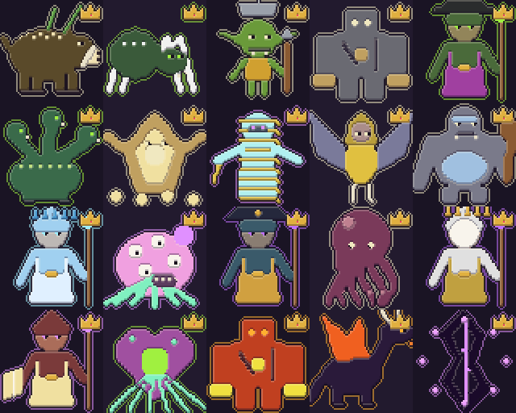
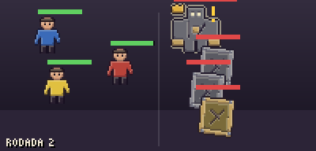
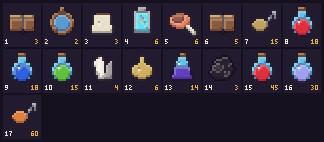
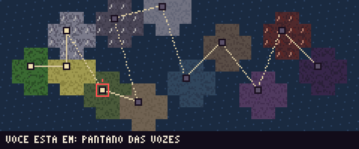

# Ecos do Véu

RPG persistente de fantasia sombria jogado inteiramente dentro do Discord: exploração, combate por turnos com intenções visíveis, ordens de trabalho automáticas, fabricação em camadas, pets domáveis que fazem missões, campanhas cooperativas para até quatro pessoas, guildas e mercado entre jogadores.

Toda a arte é pixel art gerada por código (sem arquivos de imagem no repositório além das prévias em `docs/preview`).



| Batalha | Loja (catálogo) | Mapa |
|---|---|---|
|  |  |  |

## Conteúdo

| | Quantidade |
|---|---|
| Raças | 10 (com traços, origens e opções de aparência) |
| Classes | 10, cada uma com 3 árvores de 10 nós (300 nós no total) |
| Habilidades / modificadores / passivas | 130 / 150 / 40 |
| Profissões | 10 (coleta, refino e fabricação, com especializações e mestres) |
| Regiões | 12, com clima, perigos e ~41 locais de trabalho |
| Criaturas comuns / variantes especiais / chefes | 120 / 50 / 20 |
| Itens | ~220 (materiais t1–t6, poções, comidas, runas, mapas do tesouro…) |
| Receitas | ~100, mais equipamento em camadas (base, reforço, forro, acabamento) |
| Campanhas | 5 (capítulos, votações, testes, acampamentos e chefe final) |

`npm run validate-data` confere todas as referências entre esses dados.

## Requisitos

- Node.js **22.13 ou superior** (usa o `node:sqlite` embutido; não há banco externo).
- Um aplicativo/bot criado no [Discord Developer Portal](https://discord.com/developers/applications).

## Configuração

```bash
npm install
cp .env.example .env
```

Preencha o `.env`:

| Variável | Para quê |
|---|---|
| `DISCORD_TOKEN` | Token do bot. |
| `DISCORD_CLIENT_ID` | ID do aplicativo. |
| `DEV_GUILD_ID` | (Opcional) servidor de testes: os comandos aparecem nele na hora. Sem ele, o registro é global e pode levar até uma hora. |
| `DATABASE_PATH` | Arquivo SQLite (padrão `./data/ecos.db`). |
| `JOB_INTERVAL_SECONDS` | Intervalo do processador de tarefas (padrão 30). |

Convide o bot com os escopos `bot` e `applications.commands` e as permissões *Enviar mensagens*, *Inserir links*, *Anexar arquivos*, *Criar tópicos públicos* e *Enviar mensagens em tópicos*. Nenhuma intent privilegiada é necessária.

```bash
npm run deploy-commands          # registra os comandos de barra (use --dry-run para só validar)
npm start                        # inicia o bot (npm run dev recarrega ao salvar)
```

## Comandos

| Comando | O que faz |
|---|---|
| `/personagem` | criar, ver, aparência, história, atributos, título, cinto de combate, comer |
| `/habilidades` | árvores de talento, detalhes, conjunto das 6 habilidades ativas, disciplina secundária |
| `/classe` | progresso por classe e troca no santuário |
| `/profissoes` | profissões, especializações e mestres |
| `/reputacao` | reputação com as facções |
| `/explorar` | caminhos, encontros, descobertas raras e mochila que só é guardada ao voltar |
| `/combate` | reabre o painel do combate atual |
| `/grupo` | grupos de até 4, ritmo ao vivo/assíncrono, postura automática |
| `/campanha` | iniciar, continuar, pausar, substituir membro, fragmentos |
| `/trabalhar` | planeja uma ordem de trabalho com previsão e regras de parada |
| `/atividade` | progresso, relatório e interrupção de atividades |
| `/fabricar` | receitas, equipamentos em camadas, ferramentas e fila de produção |
| `/equipamento` | equipar, visual, reparo, aprimoramento, óleos |
| `/inventario` | catálogo compacto de itens |
| `/loja` | catálogo da Companhia dos Errantes, compra e venda |
| `/viajar` | mapa do mundo e viagem entre regiões |
| `/bestiario` | criaturas vistas, pistas, materiais e descobertas |
| `/pet` | ativar, guardar, alimentar, renomear e enviar pets em missões |
| `/contratos` | contratos semanais acumuláveis |
| `/mercado` | anúncios, compra atômica e encomendas com custódia |
| `/guilda` | sede, cargos, cofre com permissões, projetos e estandarte |
| `/ajuda` | guia rápido dentro do Discord |

As interações seguem um padrão: o comando abre um **painel** (embed + botões/menus) que é editado no lugar a cada ação. Erros de regra aparecem como mensagens efêmeras com ⚠️. Em grupo, o painel de batalha é compartilhado e cada jogador recebe um painel pessoal efêmero para escolher a própria ação.

## Arquitetura

```
src/
  data/        conteúdo puro (raças, classes, itens, criaturas, regiões, receitas, campanhas…)
  game/        regras puras e determinísticas: atributos, motor de combate, simulação de trabalho, fabricação
  db/          SQLite (node:sqlite), migrações e transações aninhadas
  services/    casos de uso com banco: personagem, combate, exploração, trabalho, mercado, guilda…
  render/      encoder PNG próprio, pixel art por papéis de material, fonte 3×5, cenas
  bot/         comandos, componentes, painéis e formatação do Discord
scripts/       registro de comandos, validação de dados, exportação de sprites, simulador de balanceamento
test/          regras, serviços, conteúdo e fluxos do bot com interações simuladas
```

Princípios:

- **O banco é a fonte da verdade.** Toda operação que mexe em itens, ouro ou estado roda numa transação (`BEGIN IMMEDIATE`, com savepoints quando aninhada). Itens em uso saem do inventário para donos intermediários (cinto de combate, suprimentos de uma atividade, custódia de mercado/encomenda), então nada é gasto duas vezes nem perdido.
- **Determinismo.** Combates, ordens de trabalho e eventos usam um RNG com semente salvo junto do estado. Uma ordem de trabalho é simulada inteira a partir da semente: a previsão, a interrupção no meio e a entrega depois de um reinício produzem exatamente o mesmo resultado.
- **Reinícios seguros.** Atividades têm horário de término no banco; o processador (`processDue`) entrega o que venceu a cada `JOB_INTERVAL_SECONDS`, inclusive o que venceu com o bot desligado. Notificações vão por uma tabela de saída (outbox) e são enviadas por DM.
- **Imagens leves.** Ícones de itens e habilidades têm 16×16 (< 2 KB cada, testado) e aparecem em catálogos montados numa única imagem. Imagens maiores só para retrato do personagem, mapa, sede da guilda, árvore de talentos e cena de batalha.

## Pixel art

Cada criatura e item é desenhado em **papéis de material** (base, destaque, olho, osso…). O renderizador colore pela paleta, aplica sombreamento com luz do canto superior esquerdo e contorno automático; chefes são ampliados com Scale2x. Variantes especiais recebem um adorno que indica a mecânica (coroa de liderança, placas de carapaça, folhas de regeneração, olho de controle…). Para gerar as folhas:

```bash
npm run sprites            # gera tudo em out/sprites
npm run sprites -- --docs  # atualiza as prévias de docs/preview
```

## Testes e ferramentas

```bash
npm test                # regras de combate, serviços, integridade de conteúdo e fluxos do bot simulados
npm run typecheck
npm run validate-data   # referências entre itens, criaturas, receitas, locais, campanhas, ícones
npm run balance         # simula combates de todas as classes contra todas as regiões e chefes
```

Os testes do bot usam interações falsas do discord.js para percorrer o jogo como um jogador faria (criar personagem, explorar, lutar, trabalhar, fabricar, mercado, guilda e campanha em grupo). Eles **não** substituem um teste num servidor real: veja `docs/design.md` para o que ainda não foi validado ao vivo.

Documentação de design, hipóteses de balanceamento e o que ainda falta: [`docs/design.md`](docs/design.md).
